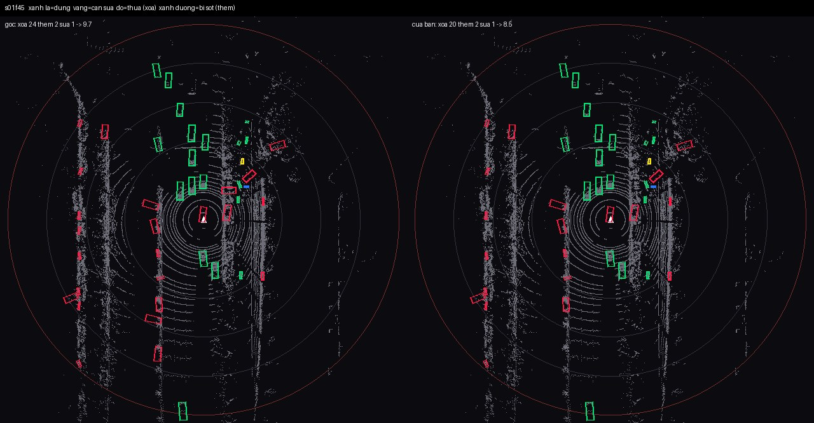

# Báo cáo Day 14 — Pham Duy Thanh — 2A202603343

- Mã học viên dùng với `--student`: `2A202603343`
- `seed_tag` trong `frames_A.txt`: `82ac3100fd`

## 1. Dự đoán trước sweep (bước 5b)

Ghi **trước** khi chạy `scripts/pp_sweep.py`, rồi commit và push ngay (lịch sử commit là bằng chứng thời điểm viết). Không sửa phần này sau khi có kết quả.

- Tham số tôi nghĩ giảm công sửa nhiều nhất: `score_thr`, tăng nhẹ từ `0.1` lên khoảng `0.3`.
- Vì sao (nhìn ảnh BEV tập A: box thừa nhiều hay box sót nhiều?): Box thừa nhiều hơn hẳn box sót. Cấu hình gốc phải xóa 35, thêm 6, sửa 2 (chi phí 17.5), phần lớn box thừa là Cyclist dọc hàng cây ở `s01f45`. 9/35 box thừa có score < 0.3, còn box đúng chỉ có 2/61, nên nâng ngưỡng lên 0.3 bỏ được box thừa mà gần như không mất box đúng. Không nâng lên 0.4–0.5, vì 18/61 box đúng có score < 0.5 và mỗi box sót tốn 1.0, gấp hơn 3 lần một box xóa (0.3). `min_points` ít tác dụng vì chỉ 2/35 box thừa có < 5 điểm.

## 2. Tập A: sửa tay và tune

| Cấu hình | Xóa | Thêm | Sửa | Chi phí |
|---|---:|---:|---:|---:|
| Gốc | 35 | 6 | 2 | 17.5 |
| `best_config.json` | 26 | 8 | 2 | 16.8 |

- Tham số đã đổi trong `best_config.json`: chỉ đổi `score_thr` từ `0.1` lên `0.3`, các tham số khác giữ như gốc (`min_points = 0`). Bớt được 9 box phải xóa nhưng sót thêm 2 box, chi phí giảm 0.7 (khoảng 4%).
- Kết quả leave-one-out (dán các dòng `scripts/pp_sweep.py` in ra):

  ```text
  s01f45: cấu hình chọn {'score_thr': '0.1', 'min_points': '5'} → 9.7 (tốt nhất có thể 8.5)
  s04f30: cấu hình chọn {'score_thr': '0.3', 'min_points': '0'} → 2.9 (tốt nhất có thể 2.3)
  s05f25: cấu hình chọn {'score_thr': '0.4', 'min_points': '0'} → 10.4 (tốt nhất có thể 4.3)
  ```

- Cấu hình có ổn định trên từng frame không? Vì sao tôi vẫn chọn (hoặc không chọn) nó: Không ổn định. Theo từng frame, chi phí của `s01f45` giảm từ 9.7 xuống 8.5 và `s04f30` giảm từ 3.5 xuống 2.9, nhưng `s05f25` tăng từ 4.3 lên 5.4 vì mất 2 box đúng có score < 0.3. Leave-one-out chọn ra 3 cấu hình khác nhau cho 3 lượt. Khi để `s05f25` ra ngoài, cấu hình chọn trên 2 frame còn lại cho chi phí 10.4, trong khi tốt nhất là 4.3: `s01f45` có quá nhiều box thừa nên kéo ngưỡng lên cao. Tôi vẫn chọn `score_thr = 0.3` vì đây là cấu hình có tổng chi phí thấp nhất và là mức vừa phải: từ 0.4 trở lên, mọi tổ hợp đều có chi phí tăng mạnh (≥ 21.6). Nếu tập B ít box thừa, `score_thr = 0.1` kết hợp `min_points = 5` (chi phí 16.9) an toàn hơn vì không làm frame nào kém hơn cấu hình gốc.

## 3. Trước/sau (bước 8)



- `scripts/pp_compare.py` báo **giảm 4%** công sửa trên tập A: tổng chi phí từ 17.5 xuống 16.8. Theo frame: `s01f45` từ 9.7 xuống 8.5, `s04f30` từ 3.5 xuống 2.9, `s05f25` tăng từ 4.3 lên 5.4.
- Dự đoán ở mục 1 đúng hay sai? Giải thích bằng số box xóa/thêm/sửa: **Đúng.** `score_thr = 0.3` cho chi phí thấp nhất, và mức giảm nhỏ như dự đoán.
  - Số box phải xóa giảm từ 35 xuống 26 (−2.7), số box phải thêm tăng từ 6 lên 8 (+2.0), số box phải sửa giữ nguyên 2. Vì vậy chi phí chỉ giảm 0.7.
  - Ảnh `s01f45`: box thừa giảm từ 24 xuống 20, số thêm (2) và sửa (1) không đổi. Phần lớn box đỏ vẫn còn: đó là dãy box dọc hai bên đường và box ngay tâm, có score 0.3–0.7 nên ngưỡng 0.3 không lọc được.
  - Khoản bị mất nằm ở `s05f25`: 2 box đúng có score < 0.3 bị lọc (số thêm từ 2 lên 4), trong khi chỉ bớt được 3 box xóa.
  - `min_points` ít tác dụng, cũng đúng như dự đoán: ở `score_thr = 0.3`, chi phí với `min_points` = 0 và 5 bằng nhau (16.8), còn `min_points = 10` làm chi phí tăng lên 17.8.

## 4. Tập B

Số đo từ `scripts/pp_prelabel.py --frames d14_2A202603343/frames_B.txt --config d14_2A202603343/best_config.json --gt d14_2A202603343/ref_B.json`:

| Xóa | Thêm | Sửa | Chi phí |
|---:|---:|---:|---:|
| 151 | 13 | 74 | 95.3 |

(12 frame: 179 box tham chiếu, 317 box dự đoán, khớp 166.)

- Loại box tốn công sửa nhất ở tập B: **Car**
  - Car thừa: 83 box phải xóa.
  - Car lệch: 61 box phải sửa.

## 5. Giới hạn

- **Chỉ có 3 frame để tune:** leave-one-out chọn ra 3 cấu hình khác nhau cho 3 lượt, và `s05f25` bị chấm 10.4 trong khi mức tốt nhất là 4.3. Sang tập B vẫn còn 151 box phải xóa, tức gần một nửa số box dự đoán là thừa, nên cấu hình chọn được không tổng quát tốt.
- **Model KITTI không có lớp Truck/Bus:** loại xe này chỉ được đổi nhãn từ `Car` theo luật kích thước. Bus và Truck bị sót (3 box ở tập A, 4 box ở tập B) không sửa được bằng cách chỉnh ngưỡng.
